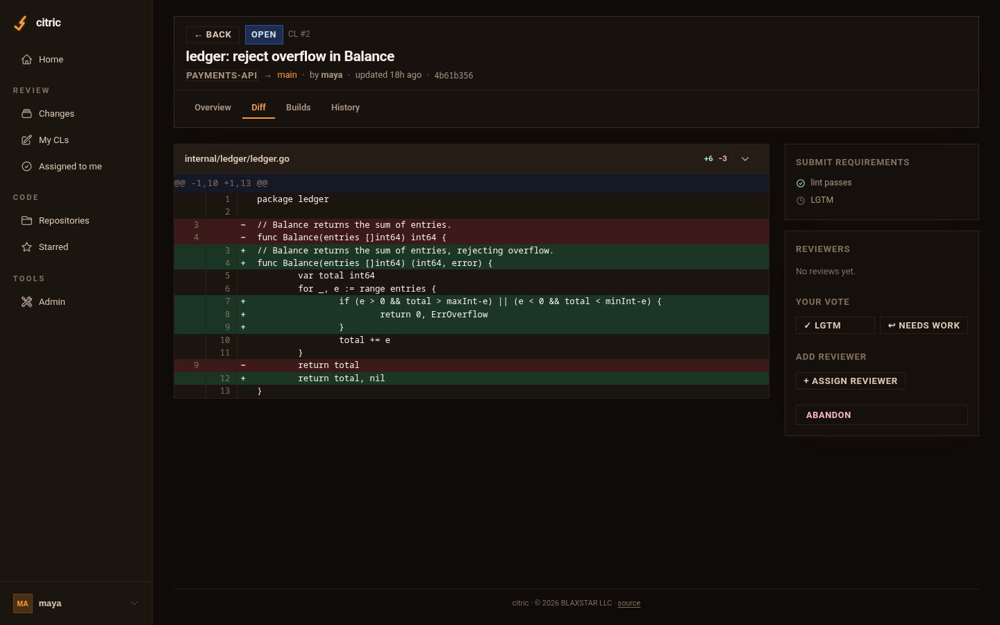

# CitriC

**Self-hosted code review and CI.** Push a change, get a CL with a diff,
reviewers, inline comments and build results; submit it when it's approved and
green. One binary, one SQLite file, no external services.



- **Gerrit-style review:** every commit is a change (CL) with patchsets, stable
  Change-Ids, stacked CLs, OWNERS files and auto-assigned reviewers.
- **Built-in CI:** lint, test, integration and format run on every patchset,
  configured per repo in `.citric.toml`; required tools gate submission. Live
  logs, cancel, re-run.
- **Build nodes:** add machines (Linux, macOS, Windows) to run builds; route
  tools to them with labels. Nodes only make outbound connections.
- **Runs anywhere:** Docker, `.deb`/`.rpm`, a single binary on Linux, macOS or
  Windows (as a native service).
- **Single sign-on** with any OpenID Connect provider, or CLI tokens.
- **Ten citrus color palettes,** dark and light; admins set the default and
  everyone can pick their own.
- **No telemetry.** CitriC never contacts anything you didn't configure.

## Quickstart (Docker)

```sh
curl -O https://raw.githubusercontent.com/blaxstar/citric/main/compose.yaml
# edit CITRIC_PUBLIC_URL in compose.yaml, then:
docker compose up -d
docker compose logs citric | grep "CLI token"
```

Install the CLI from your server and sign in:

```sh
curl -fsSL http://localhost:4400/install.sh | sh                  # macOS / Linux
irm http://localhost:4400/install.ps1 | iex                        # Windows (PowerShell)
citric auth login --server http://localhost:4400 --token <token>
```

Create a repo and send your first change:

```sh
docker compose exec citric citric repo init myproject
citric clone myproject && cd myproject
citric template --write          # generates .citric.toml for your project type
git add -A && citric commit -m "first change" && citric push
```

Open the server in a browser to review it. The `:latest-full` image used by
`compose.yaml` has Go, Node, Rust, Python/uv and common linters, so CI works
out of the box; `:latest` is git and citric only.

## Other ways to run it

| | |
| --- | --- |
| [Docker & Compose](docs/deploy/docker.md) | images, volumes, HTTPS with Caddy, upgrades |
| [Linux packages & systemd](docs/deploy/systemd.md) | `.deb`, `.rpm`, tarballs, `citric service install` |
| [Windows](docs/deploy/windows.md) | MSI, winget, Scoop, Windows service |
| [From source](docs/deploy/source.md) | `make` |
| [Reverse proxy](docs/deploy/reverse-proxy.md) | nginx, Caddy |

Then: [configuration](docs/configuration.md) · [build nodes](docs/nodes.md) ·
[security](docs/security.md) · [backups](docs/backups.md)

## License

Apache-2.0. Copyright 2026 BLAXSTAR LLC; see [NOTICE](NOTICE) and
[TRADEMARKS](TRADEMARKS.md).
